<div align="center">


# Ficha de Treino

**Ficha de musculação para o celular, com registro de cargas, sugestão de carga série a série, mapa muscular com patentes, calendário e sequência de dias treinados.**


[**Abrir o app**](https://axrthrz1n-oss.github.io/APP-GYM/)

</div>

---

## Sobre o projeto

A **Ficha de Treino** substitui a ficha de papel da academia. Ela mostra o treino do dia, guarda a carga e as repetições de cada série e, a partir desses registros, sugere a carga de cada série, diz quando subir, mostra a evolução treino a treino e acompanha a frequência ao longo do ano. Cada músculo ganha uma **patente** (de Bronze a Lenda) conforme a força registrada, mostrada num mapa muscular que dá para girar.

O app inteiro é **um único arquivo HTML**, escrito em **HTML, CSS e JavaScript puros**, sem frameworks, sem bibliotecas e sem etapa de build. Ele funciona direto no navegador, pode ser instalado na tela inicial do celular como um app (PWA) e continua funcionando sem internet.

## Capturas de tela

| Treino do dia | Sugestões por série | Descanso |
|:---:|:---:|:---:|
| 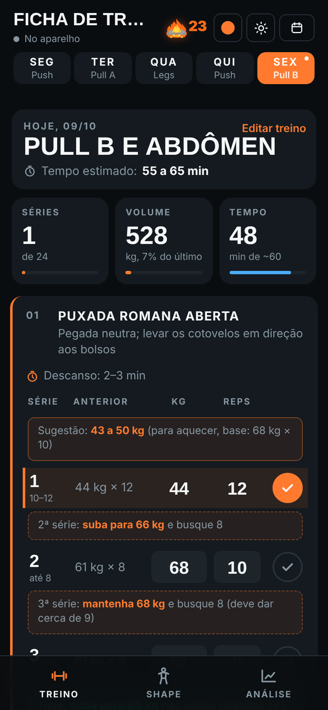 | 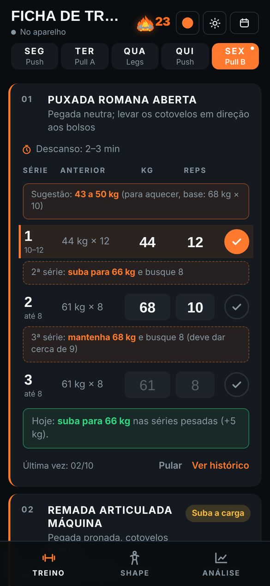 | 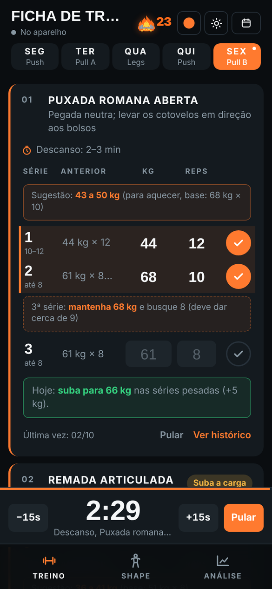 |

| Histórico com evolução | Anotações | Treino finalizado |
|:---:|:---:|:---:|
| 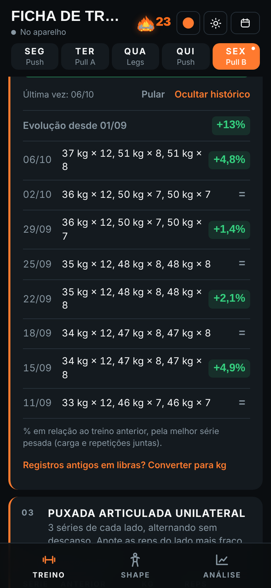 | 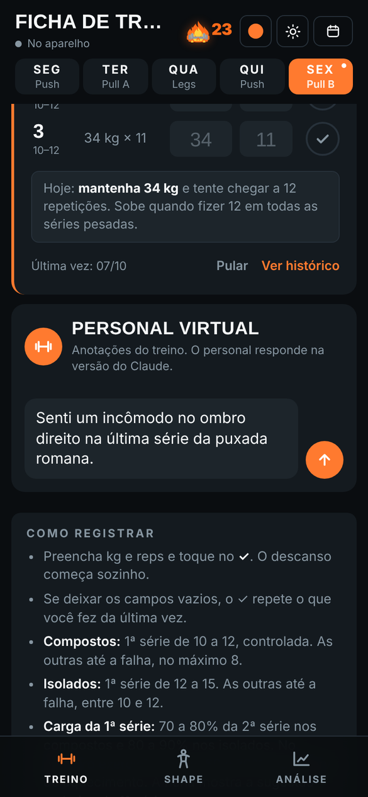 | 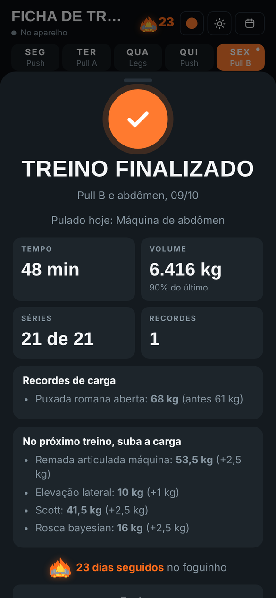 |

| Shape: frente | Shape: costas | Exercícios por porção |
|:---:|:---:|:---:|
| 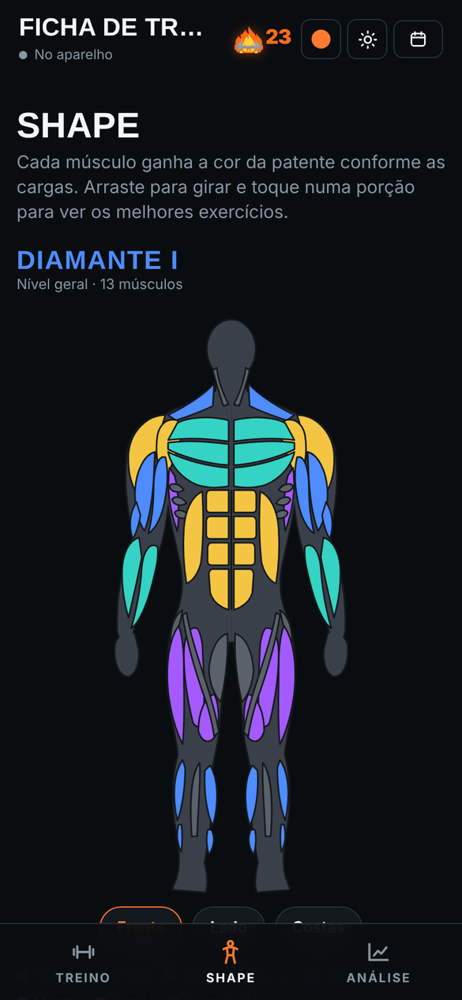 | 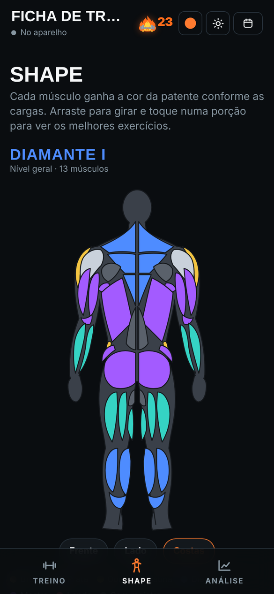 | 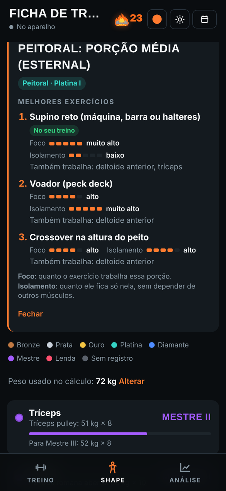 |

| Calendário | Resumo de um dia | Foguinho |
|:---:|:---:|:---:|
| 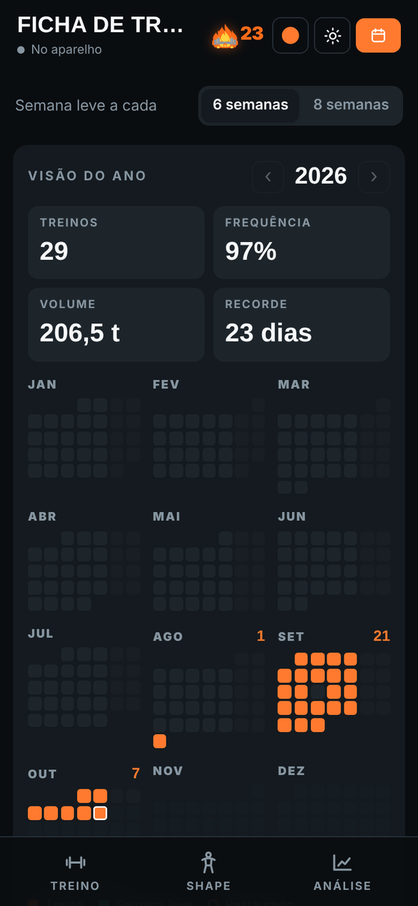 | 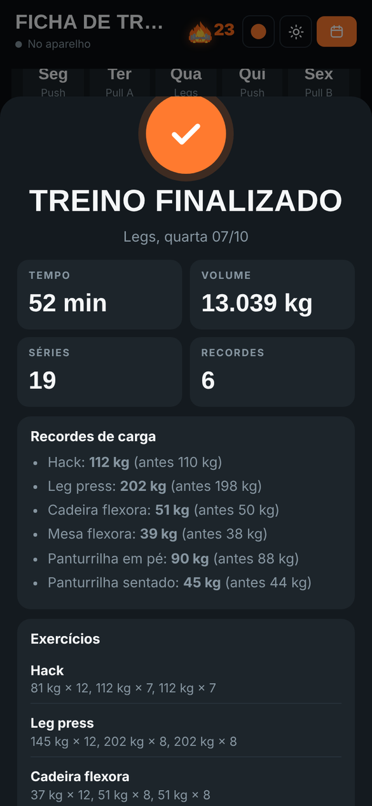 |  |

| Editor de treino | Análise | Tema claro |
|:---:|:---:|:---:|
| 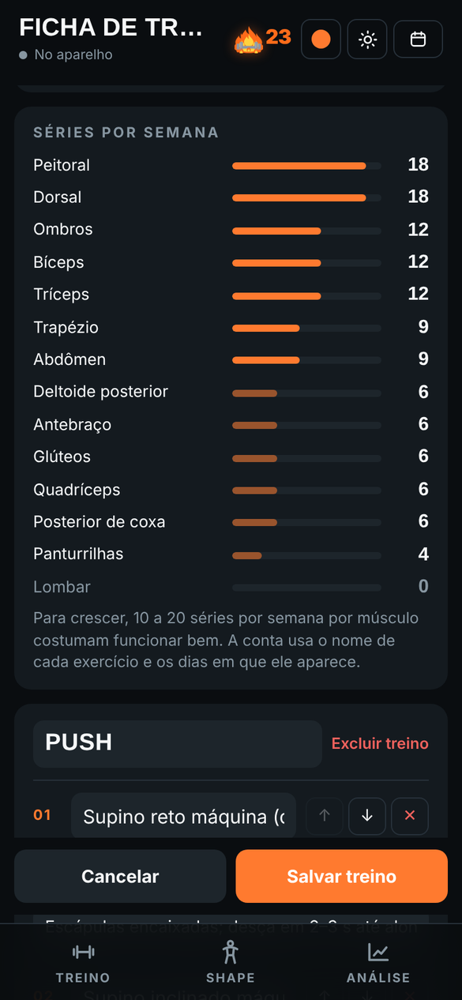 | 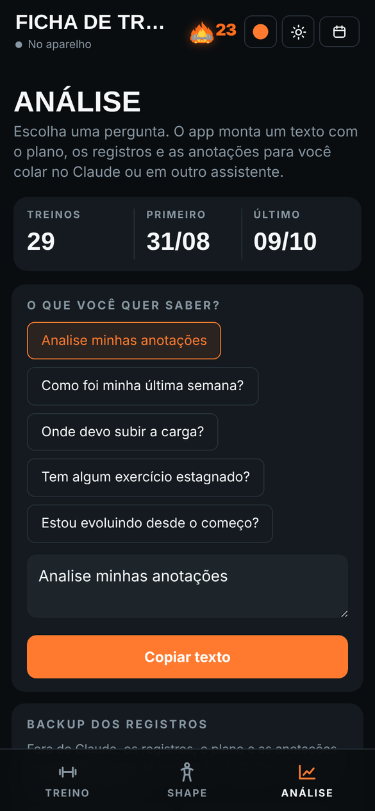 | 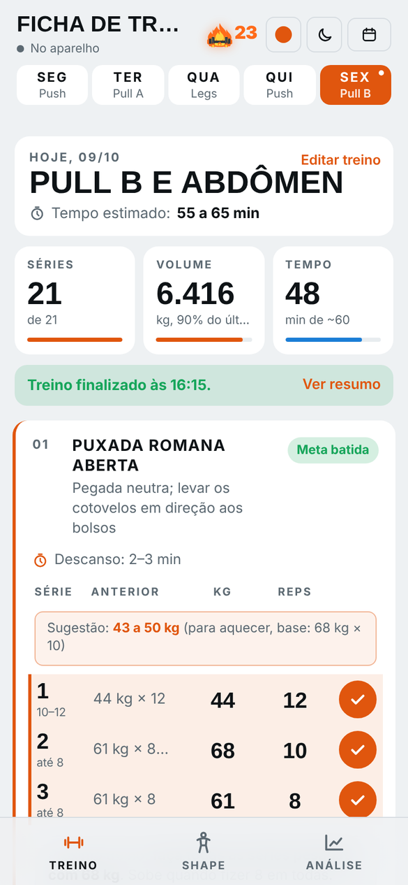 |

> As capturas usam dados de demonstração.

## Funcionalidades

### Registro do treino
- Divisão semanal **Push / Pull A / Legs / Push / Pull B**, de segunda a sexta, com abdômen às segundas, quartas e sextas. Tudo isso pode ser mudado no editor, inclusive treinar no **sábado e no domingo**.
- Para cada série: **carga, repetições e o que foi feito da última vez** na mesma série.
- O botão **✓** marca a série como feita. Com os campos vazios, ele repete os valores do último treino.
- **Cronômetro de descanso** que começa sozinho ao marcar a série, com ajuste de ±15 s, aviso sonoro e vibração.
- **Resumo do dia** com séries feitas, volume (kg × repetições) comparado ao último treino igual, e tempo de treino.
- **Pular exercício:** o treino pode ser finalizado sem ele, e o pulo fica registrado.
- **Libras para kg:** se a carga cair para menos da metade de um treino para o outro, a ficha pergunta se a unidade mudou e converte os registros antigos, com opção de desfazer.

### Sugestões série a série
Todas as sugestões consideram **carga e repetições juntas**, pela força estimada da série (fórmula de Epley: carga × (1 + repetições ÷ 30)).
- **1ª série:** faixa de carga calculada a partir da melhor série pesada: 70–80% nos compostos, 80–90% nos isolados e 60–70% no primeiro exercício do dia, que serve de aquecimento.
- **2ª série:** carga do dia com base no último treino (subir, manter ou baixar). Sem histórico, estima pela 1ª série de hoje.
- **3ª série:** ajusta pela 2ª que acabou de ser feita, já contando que costuma sair uma repetição a menos por causa do cansaço.
- **Pirâmide invertida:** nos exercícios marcados assim, a 1ª série é a mais pesada e as seguintes ficam 10–15% mais leves, com a última "até não aguentar".
- Quadro **"Hoje" / "Próximo treino"** em cada exercício, com quanto subir ou baixar, e marcação de **recorde (PR)**.

### Histórico com evolução
- Cada exercício mostra os últimos treinos com a **porcentagem de melhora** em relação ao anterior (verde quando sobe, vermelho quando cai) e a evolução total desde o primeiro registro.

### Shape: mapa muscular com patentes
- Mapa muscular de **frente, lado e costas**, que gira arrastando com o dedo ou com o mouse.
- Cada músculo é dividido nas suas **porções anatômicas** (por exemplo, peitoral superior, médio e inferior) e ganha a cor da sua **patente**: Bronze, Prata, Ouro, Platina, Diamante, Mestre e Lenda, com níveis I, II e III.
- A patente vem da força estimada do melhor exercício do músculo dividida pelo **peso corporal**.
- Lista dos músculos com patente, barra de progresso e **a carga que falta para subir**.
- Tocando numa porção, aparecem os **melhores exercícios** para ela, cada um com notas de **foco** e **isolamento**, os outros músculos que ele trabalha e a marca "No seu treino".

### Anotações
- Campo no fim de cada treino para registrar dores, desconfortos ou qualquer observação. As anotações entram na análise.

### Treino finalizado e calendário
- Ao marcar a última série do dia, abre um resumo com tempo, volume, recordes batidos e os exercícios em que a carga deve subir no próximo treino.
- **Calendário** com a visão do ano no estilo mapa de calor e as semanas com dias treinados, faltas, descansos e dias restaurados.
- **Tocar num dia** do calendário abre o resumo daquele treino: séries de cada exercício, recordes, pulos e anotações.
- **Semana leve (deload)** a cada 6 ou 8 semanas: 2 séries por exercício, parando 2 a 3 repetições antes da falha. O treino do dia se adapta sozinho.

### Foguinho (sequência de dias)
- Conta os **dias seguidos de treino**. Dias sem treino planejado (como o fim de semana, para quem não treina nele) contam como descanso e mantêm a sequência.
- Um dia de treino sem registro apaga o foguinho, a não ser que seja usada uma **restauração**: são 3 por mês, que renovam todo dia 1º e não acumulam.

### Editor de treino
- Monta os treinos e escolhe o treino de cada um dos **7 dias da semana** (ou descanso).
- **Séries por semana de cada músculo**, atualizadas enquanto o treino é montado, para ver na hora o que está sobrando ou faltando.
- Para cada exercício: nome, tipo (composto, isolado ou pirâmide invertida), número de séries, descanso e uma dica. Dá para adicionar, remover e reordenar.
- Um complemento opcional (como o abdômen) entra no fim dos dias marcados.

### Análise e backup
- Monta um texto pronto com o plano, os registros e as anotações para colar no Claude ou em qualquer assistente.
- **Backup** dos registros, do plano e das configurações em JSON, com exportação e importação.

### Personalização
- **Tema claro, escuro ou automático**, com botão de troca rápida no topo.
- **Cor principal** com 8 opções prontas ou qualquer cor personalizada.

### Recursos extras quando publicado como artifact no Claude
- **Ranking entre amigos** convidados para a mesma ficha (foguinho, treinos no mês, frequência, evolução e, para quem permitir, cargas).
- **Comparação de shape** com os amigos, músculo por músculo.
- **Personal virtual**: responde às anotações em forma de conversa e comenta o treino ao finalizar.
- **Personal no editor**: a cada exercício adicionado, dá uma dica sobre o que acrescentar, tirar ou trocar, com espaço para responder, e analisa o treino completo antes de salvar.
- Registros salvos na conta de cada pessoa, sincronizados entre aparelhos. Quem entra pela primeira vez monta o próprio treino do zero.

## Tecnologias

| Área | O que foi usado |
|---|---|
| Linguagens | HTML5, CSS3 e JavaScript (ES2020), sem frameworks nem build |
| Layout | CSS Grid, Flexbox, variáveis CSS, `color-mix()` e `prefers-color-scheme` |
| Gráficos | SVG desenhado à mão para o mapa muscular, girado com Pointer Events |
| Dados | `localStorage`, com exportação e importação de backup em JSON |
| App instalável | Web App Manifest e Service Worker (funciona offline) |
| APIs do navegador | Web Audio (bipe do descanso), Clipboard, Web Share e Vibration |
| Fontes | Barlow e Barlow Condensed (Google Fonts) |
| Integração opcional | Runtime de artifacts do Claude (`window.claude`) para salvar na conta, ranking e personal virtual |

## Como usar

### Direto no navegador
Abra o `index.html`. Para o modo offline funcionar, sirva a pasta por HTTP:

```bash
python3 -m http.server 8000
# depois abra http://localhost:8000
```

### Publicar no GitHub Pages
1. Suba os arquivos para um repositório público.
2. Em **Settings → Pages**, escolha a branch `main` e a pasta `/ (root)`.
3. O app fica disponível em `https://axrthrz1n-oss.github.io/APP-GYM/`.

### Instalar no celular
- **iPhone (Safari):** Compartilhar → **Adicionar à Tela de Início**.
- **Android (Chrome):** menu ⋮ → **Instalar app** ou **Adicionar à tela inicial**.

O app abre em tela cheia, com ícone próprio, e funciona sem internet.

## Estrutura do projeto

```
ficha-de-treino/
├── index.html            # o app inteiro: HTML, CSS e JavaScript
├── manifest.webmanifest  # nome, cores e ícones do app instalável
├── sw.js                 # service worker (cache para uso offline)
├── icons/                # ícones do app (180, 192 e 512 px)
├── docs/                 # capturas de tela do README
├── LICENSE
└── README.md
```

## Como os dados são salvos

- **Fora do Claude:** tudo fica no `localStorage` do navegador do próprio aparelho, nas chaves `ficha-treino-v1` (treinos e anotações), `ficha-plan-v1` (plano montado no editor), `ficha-config-v1` (semanas leves, restaurações, cor e peso corporal) e `ficha-theme-v1` (tema). Nada é enviado para servidor nenhum. Use **Análise → Exportar backup** de vez em quando.
- **Publicado como artifact no Claude:** os registros ficam salvos na conta de cada usuário, numa área privada, e sincronizam entre o celular e o computador. No ranking aparece só o que cada pessoa escolher mostrar.

## Personalizar o treino

O jeito mais fácil é pelo próprio app: toque em **Editar treino**, no card do dia. O plano montado ali fica salvo no aparelho e entra no backup.

O treino que vem de fábrica fica nas constantes `WORKOUTS`, `DAYS` e `EXTRA`, no início do `<script>` do `index.html`:

```js
push: {name:"Push", exercises:[
  {id:"supino-reto-deitado", name:"Supino reto máquina (deitado)", sets:A(3), ...HEAVY},
  {id:"supino-inclinado", name:"Supino inclinado máquina", sets:A(3), ...HEAVY},
  {id:"crossover", name:"Crossover", sets:A(3), ...LIGHT, tip:"Puxar de cima para baixo"},
  // ...
]}
```

- `A(n)`: n séries no esquema de compostos (1ª de 10–12 repetições, as outras até 8, até a falha).
- `B(n)`: n séries no esquema de isolados (1ª de 12–15, as outras de 10–12).
- `P(n)` com `pyramid:true`: pirâmide invertida (1ª de 8–12, depois 12–15 e a última até não aguentar).
- `HEAVY` e `LIGHT`: descanso de 2–3 min ou de 1–1,5 min.
- `id`: identificador fixo do exercício. Mudar o `id` faz o exercício perder o histórico.

## Regras de progressão

A ficha calcula a força estimada da **série pesada mais fraca** e procura a carga que daria a meta de repetições. O ajuste é arredondado em degraus de 1 kg (abaixo de 10 kg), 2,5 kg (de 10 a 60 kg) ou 5 kg (acima de 60 kg).

| Situação nas séries pesadas | O que a ficha sugere |
|---|---|
| Bateu a meta de repetições em todas | Subir de 1 a 3 degraus, conforme quanto passou da meta |
| Ficou dentro da faixa | Manter a carga e buscar mais repetições |
| Ficou abaixo de 5 (compostos) ou 8 (isolados) | Baixar de 1 a 3 degraus |

Na pirâmide invertida, a referência é só a 1ª série.

## Aviso

Este projeto é uma ferramenta de registro e organização. As patentes são uma estimativa (máquinas variam entre academias) e o app não substitui a orientação de um profissional de educação física ou de saúde.

## Autor

Desenvolvido por **Arthur Ferraz de Aquino**, estudante de Ciência da Computação, com auxílio do Claude (Anthropic).

## Licença

Distribuído sob a licença MIT. Veja o arquivo [LICENSE](LICENSE).
