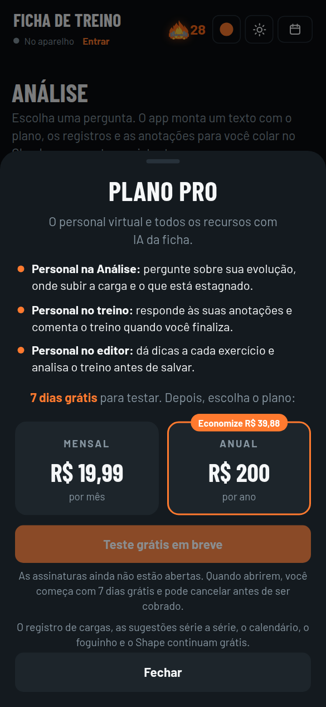
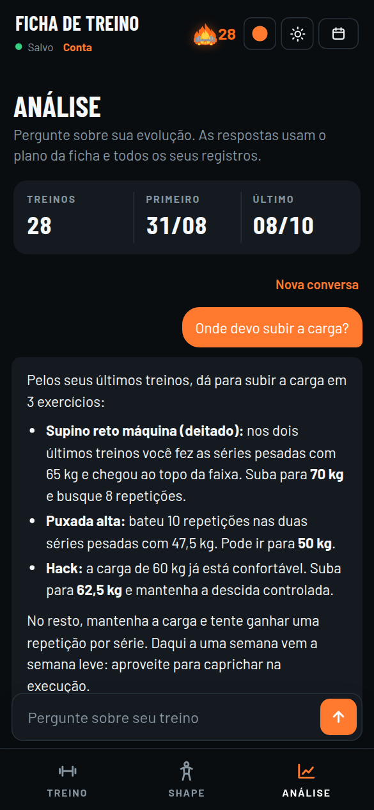

<div align="center">


# Ficha de Treino

**Ficha de musculação para o celular, com registro de cargas, sugestão de carga série a série, mapa muscular com patentes, calendário, sequência de dias treinados e personal virtual com IA.**


[**Abrir o app**](https://axrthrz1n-oss.github.io/APP-GYM/)

</div>

---

## Sobre o projeto

A **Ficha de Treino** substitui a ficha de papel da academia. Ela mostra o treino do dia, guarda a carga e as repetições de cada série e, a partir desses registros, sugere a carga de cada série, diz quando subir, mostra a evolução treino a treino e acompanha a frequência ao longo do ano. Cada músculo ganha uma **patente** (de Bronze a Lenda) conforme a força registrada, mostrada num mapa muscular que dá para girar.

A ficha é escrita em **HTML, CSS e JavaScript puros**, sem frameworks e sem etapa de build: o app inteiro está no `index.html`. Ele funciona direto no navegador, pode ser instalado na tela inicial do celular como um app (PWA) e continua funcionando sem internet.

A **conta na nuvem** e o **personal virtual** são opcionais. Eles usam o [Supabase](https://supabase.com) e a API do Claude e só ligam quando o `config.js` está preenchido. Fora do Claude, o personal faz parte do **Plano Pro**, uma assinatura de R$ 19,99 por mês ou R$ 200 por ano, com 7 dias grátis, que ainda não está à venda.

## Capturas de tela

| Treino do dia | Sugestões por série | Descanso |
|:---:|:---:|:---:|
|  |  |  |

| Histórico com evolução | Anotações | Treino finalizado |
|:---:|:---:|:---:|
|  |  |  |

| Shape: frente | Shape: costas | Exercícios por porção |
|:---:|:---:|:---:|
|  |  |  |

| Calendário | Resumo de um dia | Foguinho |
|:---:|:---:|:---:|
|  |  |  |

| Editor de treino | Análise | Tema claro |
|:---:|:---:|:---:|
|  |  |  |

| Entrar com e-mail | Plano Pro | Personal virtual |
|:---:|:---:|:---:|
|  |  |  |

> As capturas usam dados de demonstração.

## Funcionalidades

### Registro do treino
- Divisão semanal **Push / Pull A / Legs / Push / Pull B**, de segunda a sexta, com abdômen às segundas, quartas e sextas. Tudo isso pode ser mudado no editor, inclusive treinar no **sábado e no domingo**.
- Para cada série: **carga, repetições e o que foi feito da última vez** na mesma série.
- O botão **✓** marca a série como feita. Com os campos vazios, ele repete os valores do último treino.
- **Cronômetro de descanso** que começa sozinho ao marcar a série, com ajuste de ±15 s, aviso sonoro e vibração.
- **Resumo do dia** com séries feitas, volume (kg × repetições) comparado ao último treino igual, e tempo de treino.
- **Pular exercício:** o treino pode ser finalizado sem ele, e o pulo fica registrado.
- **Libras para kg:** se a carga cair para menos da metade de um treino para o outro, a ficha pergunta se a unidade mudou e converte os registros antigos, com opção de desfazer.

### Sugestões série a série
Todas as sugestões consideram **carga e repetições juntas**, pela força estimada da série (fórmula de Epley: carga × (1 + repetições ÷ 30)).
- **1ª série:** faixa de carga calculada a partir da melhor série pesada: 70–80% nos compostos, 80–90% nos isolados e 60–70% no primeiro exercício do dia, que serve de aquecimento.
- **2ª série:** carga do dia com base no último treino (subir, manter ou baixar). Sem histórico, estima pela 1ª série de hoje.
- **3ª série:** ajusta pela 2ª que acabou de ser feita, já contando que costuma sair uma repetição a menos por causa do cansaço.
- **Pirâmide invertida:** nos exercícios marcados assim, a 1ª série é a mais pesada e as seguintes ficam 10–15% mais leves, com a última "até não aguentar".
- Quadro **"Hoje" / "Próximo treino"** em cada exercício, com quanto subir ou baixar, e marcação de **recorde (PR)**.

### Histórico com evolução
- Cada exercício mostra os últimos treinos com a **porcentagem de melhora** em relação ao anterior (verde quando sobe, vermelho quando cai) e a evolução total desde o primeiro registro.

### Shape: mapa muscular com patentes
- Mapa muscular de **frente, lado e costas**, que gira arrastando com o dedo ou com o mouse.
- Cada músculo é dividido nas suas **porções anatômicas** (por exemplo, peitoral superior, médio e inferior) e ganha a cor da sua **patente**: Bronze, Prata, Ouro, Platina, Diamante, Mestre e Lenda, com níveis I, II e III.
- A patente vem da força estimada do melhor exercício do músculo dividida pelo **peso corporal**.
- Lista dos músculos com patente, barra de progresso e **a carga que falta para subir**.
- Tocando numa porção, aparecem os **melhores exercícios** para ela, cada um com notas de **foco** e **isolamento**, os outros músculos que ele trabalha e a marca "No seu treino".

### Anotações
- Campo no fim de cada treino para registrar dores, desconfortos ou qualquer observação. As anotações entram na análise.

### Treino finalizado e calendário
- Ao marcar a última série do dia, abre um resumo com tempo, volume, recordes batidos e os exercícios em que a carga deve subir no próximo treino.
- **Calendário** com a visão do ano no estilo mapa de calor e as semanas com dias treinados, faltas, descansos e dias restaurados.
- **Tocar num dia** do calendário abre o resumo daquele treino: séries de cada exercício, recordes, pulos e anotações.
- **Semana leve (deload)** a cada 6 ou 8 semanas: 2 séries por exercício, parando 2 a 3 repetições antes da falha. O treino do dia se adapta sozinho.

### Foguinho (sequência de dias)
- Conta os **dias seguidos de treino**. Dias sem treino planejado (como o fim de semana, para quem não treina nele) contam como descanso e mantêm a sequência.
- Um dia de treino sem registro apaga o foguinho, a não ser que seja usada uma **restauração**: são 3 por mês, que renovam todo dia 1º e não acumulam.

### Editor de treino
- Monta os treinos e escolhe o treino de cada um dos **7 dias da semana** (ou descanso).
- **Séries por semana de cada músculo**, atualizadas enquanto o treino é montado, para ver na hora o que está sobrando ou faltando.
- Para cada exercício: nome, tipo (composto, isolado ou pirâmide invertida), número de séries, descanso e uma dica. Dá para adicionar, remover e reordenar.
- Um complemento opcional (como o abdômen) entra no fim dos dias marcados.

### Análise e backup
- Monta um texto pronto com o plano, os registros e as anotações para colar no Claude ou em qualquer assistente.
- **Backup** dos registros, do plano e das configurações em JSON, com exportação e importação.

### Personalização
- **Tema claro, escuro ou automático**, com botão de troca rápida no topo.
- **Cor principal** com 8 opções prontas ou qualquer cor personalizada.

### Recursos extras quando publicado como artifact no Claude
- **Ranking entre amigos** convidados para a mesma ficha (foguinho, treinos no mês, frequência, evolução e, para quem permitir, cargas).
- **Comparação de shape** com os amigos, músculo por músculo.
- **Personal virtual**: responde às anotações em forma de conversa e comenta o treino ao finalizar.
- **Personal no editor**: a cada exercício adicionado, dá uma dica sobre o que acrescentar, tirar ou trocar, com espaço para responder, e analisa o treino completo antes de salvar.
- Registros salvos na conta de cada pessoa, sincronizados entre aparelhos. Quem entra pela primeira vez monta o próprio treino do zero.

### Conta na nuvem (opcional, fora do Claude)
Com o `config.js` preenchido (veja [Ligar a conta na nuvem](#ligar-a-conta-na-nuvem-supabase)), a versão publicada no GitHub Pages ganha:
- **Entrar com e-mail**, sem senha: a pessoa recebe um código e digita no app.
- **Treinos, plano, anotações e configurações salvos na nuvem**, sincronizados entre o celular e o computador.
- **Os registros do aparelho vão junto** no primeiro login. Se a conta já tiver dados, vale o que estiver mais novo em cada treino, e o plano da conta é mantido.
- **Personal virtual e personal no editor** funcionando fora do Claude, pela API do Claude, para quem tem o [Plano Pro](#plano-pro-em-breve), com limite diário de mensagens por pessoa.
- **Sair da conta** apaga os treinos do aparelho e mantém tudo na nuvem.

Sem o `config.js` preenchido, nada muda: a ficha continua salvando só no aparelho.

### Plano Pro (em breve)
Fora do Claude, o personal virtual e os outros recursos com IA fazem parte de uma assinatura:

| Plano | Preço |
|---|---|
| Mensal | R$ 19,99 por mês |
| Anual | R$ 200 por ano (economia de R$ 39,88) |
| Teste grátis | 7 dias, nos dois planos |

- **Inclui:** personal na Análise, personal no treino (responde às anotações e comenta o treino ao finalizar) e personal no editor (dicas a cada exercício e análise antes de salvar).
- **Continua grátis:** registro de cargas, sugestões série a série, histórico, calendário, foguinho, Shape, editor de treino e backup.
- **Limite:** 15 mensagens com o personal por pessoa por dia, para manter o custo da IA sob controle.
- **Ainda não está à venda:** o app mostra os planos e o teste grátis, e o botão aparece como **Teste grátis em breve**, desligado.
- **No Claude**, o Plano Pro não aparece: lá a IA usa a conta de quem abre a ficha.
- **Modelo de IA:** o personal usa o Claude Haiku 5.5, o mais barato. Veja a conta em [Plano Pro: custos e lucro estimados](#plano-pro-custos-e-lucro-estimados).

## Tecnologias

| Área | O que foi usado |
|---|---|
| Linguagens | HTML5, CSS3 e JavaScript (ES2020), sem frameworks nem build |
| Layout | CSS Grid, Flexbox, variáveis CSS, `color-mix()` e `prefers-color-scheme` |
| Gráficos | SVG desenhado à mão para o mapa muscular, girado com Pointer Events |
| Dados | `localStorage`, com exportação e importação de backup em JSON |
| App instalável | Web App Manifest e Service Worker (funciona offline) |
| APIs do navegador | Web Audio (bipe do descanso), Clipboard, Web Share e Vibration |
| Fontes | Barlow e Barlow Condensed (Google Fonts) |
| Integração opcional | Runtime de artifacts do Claude (`window.claude`) para salvar na conta, ranking e personal virtual |
| Conta na nuvem (opcional) | Supabase: login por código no e-mail, Postgres com regras por usuário (RLS), tempo real entre aparelhos e uma Edge Function que chama a API do Claude para o personal virtual |

## Como usar

### Direto no navegador
Abra o `index.html`. Para o modo offline funcionar, sirva a pasta por HTTP:

```bash
python3 -m http.server 8000
# depois abra http://localhost:8000
```

### Publicar no GitHub Pages
1. Suba os arquivos para um repositório público.
2. Em **Settings → Pages**, escolha a branch `main` e a pasta `/ (root)`.
3. O app fica disponível em `https://axrthrz1n-oss.github.io/APP-GYM/`.

### Ligar a conta na nuvem (Supabase)
Tudo isso é feito uma vez, no painel do [Supabase](https://supabase.com) (tem plano gratuito) e no [Console da Anthropic](https://console.anthropic.com).

1. **Crie um projeto** no Supabase.
2. **Crie as tabelas:** em **SQL Editor → New query**, cole o conteúdo de [`supabase/schema.sql`](supabase/schema.sql) e toque em **Run**.
3. **Ligue o login por código:** em **Authentication → Emails**, edite os modelos **Magic Link** e **Confirm signup** para mostrar o código, por exemplo: `Seu código da Ficha de Treino: {{ .Token }}`.
4. **Endereço do app:** em **Authentication → URL Configuration**, coloque `https://axrthrz1n-oss.github.io/APP-GYM/` em **Site URL**.
5. **Personal virtual:**
   - crie uma chave de API no Console da Anthropic;
   - no Supabase, em **Edge Functions → Secrets**, adicione `ANTHROPIC_API_KEY` com essa chave;
   - publique a função [`supabase/functions/personal`](supabase/functions/personal/index.ts) com a CLI do Supabase:
     ```bash
     npx supabase login
     npx supabase functions deploy personal --project-ref SEU-PROJECT-REF
     ```
6. **Conecte o app:** em **Project Settings → API**, copie a **Project URL** e a chave **anon** (ou **publishable**) para o [`config.js`](config.js), faça o commit e publique.

Ajustes opcionais do personal, também em **Edge Functions → Secrets**:

| Segredo | Padrão | Para que serve |
|---|---|---|
| `PERSONAL_MODEL` | `claude-haiku-5-5` | Modelo do Claude usado nas respostas. O Haiku é o mais barato; `claude-sonnet-5-5` e `claude-opus-5-5` respondem melhor e custam bem mais |
| `PERSONAL_EFFORT` | `low` | Quanto o modelo pensa antes de responder (`low`, `medium` ou `high`) |
| `PERSONAL_DAILY_LIMIT` | `15` | Mensagens por pessoa por dia |
| `PERSONAL_REQUIRE_PRO` | `true` | Só quem tem o Plano Pro usa o personal. `false` libera para todos (por exemplo, num teste com amigos) |

**Plano Pro no servidor:** o `schema.sql` cria a tabela `subscriptions`, que o app só lê, e a função do personal confere a assinatura antes de chamar a API do Claude. Sem ela, a resposta é recusada mesmo que alguém mexa no app. Enquanto o pagamento não existe, dá para liberar o Plano Pro para uma conta à mão, em **SQL Editor**:

```sql
insert into public.subscriptions (user_id, plan, status, current_period_end)
select id, 'anual', 'active', now() + interval '1 year' from auth.users where email = 'seu@email.com'
on conflict (user_id) do update set plan = excluded.plan, status = excluded.status, current_period_end = excluded.current_period_end;
```

Para cobrar de verdade, falta ligar um meio de pagamento que grave nessa tabela pelo servidor, com a chave **service_role**. Nos apps da App Store e do Google Play, assinaturas de recursos digitais precisam passar pela compra dentro do app de cada loja. O teste grátis entra na tabela com o status `trialing` e o fim do teste em `current_period_end`. As lojas já garantem um teste por pessoa; num pagamento pelo site, o servidor precisa conferir isso.

Cuidados:
- A chave **anon/publishable** é pública e pode ficar no `config.js`: quem protege os dados são as regras do banco, e cada pessoa só lê e grava os próprios registros. Nunca coloque no repositório a chave **service_role** nem a chave da Anthropic.
- O e-mail que vem com o Supabase serve para testar e envia poucos e-mails por hora. Antes de abrir para mais gente, configure um SMTP próprio em **Authentication → SMTP Settings**.

### Instalar no celular
- **iPhone (Safari):** Compartilhar → **Adicionar à Tela de Início**.
- **Android (Chrome):** menu ⋮ → **Instalar app** ou **Adicionar à tela inicial**.

O app abre em tela cheia, com ícone próprio, e funciona sem internet.

## Estrutura do projeto

```
ficha-de-treino/
├── index.html            # o app inteiro: HTML, CSS e JavaScript
├── manifest.webmanifest  # nome, cores e ícones do app instalável
├── sw.js                 # service worker (cache para uso offline)
├── config.js             # endereço e chave pública do Supabase (vazio = só no aparelho)
├── cloud.js              # conta na nuvem: login, sincronização e personal virtual
├── vendor/               # biblioteca do Supabase (carregada só com a conta ligada)
├── supabase/
│   ├── schema.sql        # tabelas, regras de acesso e assinaturas do Plano Pro
│   └── functions/personal/index.ts  # função que chama a API do Claude
├── icons/                # ícones do app (180, 192 e 512 px)
├── docs/                 # capturas de tela do README
├── LICENSE
└── README.md
```

## Como os dados são salvos

- **Fora do Claude:** tudo fica no `localStorage` do navegador do próprio aparelho, nas chaves `ficha-treino-v1` (treinos e anotações), `ficha-plan-v1` (plano montado no editor), `ficha-config-v1` (semanas leves, restaurações, cor e peso corporal) e `ficha-theme-v1` (tema). Nada é enviado para servidor nenhum. Use **Análise → Exportar backup** de vez em quando.
- **Publicado como artifact no Claude:** os registros ficam salvos na conta de cada usuário, numa área privada, e sincronizam entre o celular e o computador. No ranking aparece só o que cada pessoa escolher mostrar.
- **Com a conta na nuvem (Supabase):** os treinos, o plano e as configurações ficam na tabela `user_docs`, uma linha por documento, e só o dono lê e grava. O aparelho guarda uma cópia para funcionar sem internet e envia as mudanças quando a conexão volta. A função do personal não guarda as conversas: ela confere o Plano Pro em `subscriptions`, repassa a pergunta para a API do Claude e conta o uso do dia em `ai_usage`. As respostas do personal no card do treino ficam salvas junto do treino; a conversa da aba Análise fica só no aparelho.

## Plano Pro: custos e lucro estimados

Conta feita antes do lançamento, para escolher o modelo de IA e o limite diário. Os números reais aparecem no Console da Anthropic depois dos primeiros assinantes.

**Premissas**
- Cada mensagem ao personal leva junto o histórico de treinos: cerca de 10 mil tokens de entrada e mil de resposta.
- **Uso normal:** cerca de 65 mensagens por mês, para quem treina 4 vezes por semana. **Uso máximo:** 15 por dia, ou 450 por mês.
- US$ 1 ≈ R$ 5,50.
- Da receita saem 15% de taxa da loja e cerca de 6% de imposto. De R$ 19,99 sobram **R$ 15,79 por mês**. Do anual de R$ 200, sobram **R$ 13,17 por mês**.

**Custo de IA por assinante por mês**

| Modelo | Preço por milhão de tokens (entrada / saída) | Uso normal | Uso máximo |
|---|---|---|---|
| Claude Haiku 5.5 (padrão) | US$ 0,10 / US$ 0,50 | R$ 0,55 a R$ 0,70 | R$ 3,70 a R$ 4,80 |
| Claude Sonnet 5.5 | US$ 2 / US$ 10 | R$ 11 | R$ 74 |
| Claude Opus 5.5 | US$ 4 / US$ 20 | R$ 21 | R$ 149 |

No Haiku 5.5, o mesmo texto conta cerca de 30% mais tokens, por isso a faixa.

**Lucro por assinante por mês**

| Modelo | Mensal, uso normal | Anual, uso normal | Mensal, uso máximo |
|---|---|---|---|
| Claude Haiku 5.5 (padrão) | +R$ 15,25 | +R$ 12,63 | +R$ 12,08 |
| Claude Sonnet 5.5 | +R$ 5,06 | +R$ 2,44 | −R$ 58,46 |
| Claude Opus 5.5 | −R$ 5,66 | −R$ 8,28 | −R$ 132,71 |

- **Teste grátis:** cada teste de 7 dias (umas 15 mensagens) custa poucos centavos com o Haiku, R$ 2,48 com o Sonnet e R$ 4,95 com o Opus.
- **Exemplo com 100 assinantes mensais de uso normal**, tirando uns R$ 185 por mês de custos fixos (plano pago do Supabase e conta de desenvolvedor da Apple):
  - Haiku: cerca de R$ 1.340 de lucro por mês.
  - Sonnet: cerca de R$ 320 de lucro por mês.
  - Opus: cerca de R$ 750 de prejuízo por mês.
- **Por isso o padrão é o Haiku 5.5 com limite de 15 mensagens por dia.** Antes de abrir as assinaturas, vale testar a qualidade das respostas com perguntas reais. Para trocar de modelo, basta mudar o segredo `PERSONAL_MODEL`.
- Recebendo como pessoa física, o imposto pode chegar a 27,5%, e o lucro cai. Os preços das APIs e o câmbio mudam: confira antes de decidir.

## Personalizar o treino

O jeito mais fácil é pelo próprio app: toque em **Editar treino**, no card do dia. O plano montado ali fica salvo no aparelho e entra no backup.

O treino que vem de fábrica fica nas constantes `WORKOUTS`, `DAYS` e `EXTRA`, no início do `<script>` do `index.html`:

```js
push: {name:"Push", exercises:[
  {id:"supino-reto-deitado", name:"Supino reto máquina (deitado)", sets:A(3), ...HEAVY},
  {id:"supino-inclinado", name:"Supino inclinado máquina", sets:A(3), ...HEAVY},
  {id:"crossover", name:"Crossover", sets:A(3), ...LIGHT, tip:"Puxar de cima para baixo"},
  // ...
]}
```

- `A(n)`: n séries no esquema de compostos (1ª de 10–12 repetições, as outras até 8, até a falha).
- `B(n)`: n séries no esquema de isolados (1ª de 12–15, as outras de 10–12).
- `P(n)` com `pyramid:true`: pirâmide invertida (1ª de 8–12, depois 12–15 e a última até não aguentar).
- `HEAVY` e `LIGHT`: descanso de 2–3 min ou de 1–1,5 min.
- `id`: identificador fixo do exercício. Mudar o `id` faz o exercício perder o histórico.

## Regras de progressão

A ficha calcula a força estimada da **série pesada mais fraca** e procura a carga que daria a meta de repetições. O ajuste é arredondado em degraus de 1 kg (abaixo de 10 kg), 2,5 kg (de 10 a 60 kg) ou 5 kg (acima de 60 kg).

| Situação nas séries pesadas | O que a ficha sugere |
|---|---|
| Bateu a meta de repetições em todas | Subir de 1 a 3 degraus, conforme quanto passou da meta |
| Ficou dentro da faixa | Manter a carga e buscar mais repetições |
| Ficou abaixo de 5 (compostos) ou 8 (isolados) | Baixar de 1 a 3 degraus |

Na pirâmide invertida, a referência é só a 1ª série.

## Próximos passos

1. **Validar:** colocar 20 a 30 pessoas da academia para usar e ver quantas continuam depois de 4 semanas.
2. **Ligar a conta na nuvem:** criar o projeto no Supabase, seguindo [Ligar a conta na nuvem](#ligar-a-conta-na-nuvem-supabase), e testar as respostas do personal com perguntas reais.
3. **E-mail de login:** configurar um SMTP próprio antes de abrir para mais gente.
4. **Apagar a conta:** adicionar o botão **Apagar minha conta**, exigido pela Apple e pelo Google.
5. **Pagamento:** no site, um meio de pagamento como Mercado Pago, Stripe ou Pix, que grave a assinatura em `subscriptions`. Nas lojas, a compra dentro do app.
6. **Lojas:**
   - Google Play primeiro, empacotando o PWA com o PWABuilder ou o Bubblewrap.
   - Depois a App Store, com o Capacitor e recursos nativos, como notificação no fim do descanso, Apple Saúde e widget do foguinho.
7. **Amigos fora do Claude:** ranking e comparação de shape com grupos e convites.
8. **Plano para personal trainers:** painel com os alunos, cobrado por personal.

## Histórico de versões

| Data | O que mudou |
|---|---|
| 30/09/2026 | Primeira versão: registro de cargas, progressão automática, treino finalizado, foguinho, calendário, análise e personalização. |
| 01/10/2026 | Editor de treino, sugestões série a série, histórico com evolução, anotações e recursos extras no Claude. |
| 09/10/2026 | Shape com patentes, tema claro e escuro, resumo do dia no calendário, treino em qualquer dia da semana e contador de séries no editor. |
| 09/10/2026 | Conta na nuvem opcional (Supabase): login por código no e-mail, sincronização entre aparelhos e personal virtual fora do Claude. |
| 09/10/2026 | Plano Pro: R$ 19,99 por mês ou R$ 200 por ano, 7 dias grátis (ainda não à venda), limite de 15 mensagens por dia e personal com o Claude Haiku 5.5. |

## Aviso

Este projeto é uma ferramenta de registro e organização. As patentes são uma estimativa (máquinas variam entre academias) e o app não substitui a orientação de um profissional de educação física ou de saúde.

## Autor

Desenvolvido por **Arthur Ferraz de Aquino**, estudante de Ciência da Computação, com auxílio do Claude (Anthropic).

## Licença

Distribuído sob a licença MIT. Veja o arquivo [LICENSE](LICENSE).
